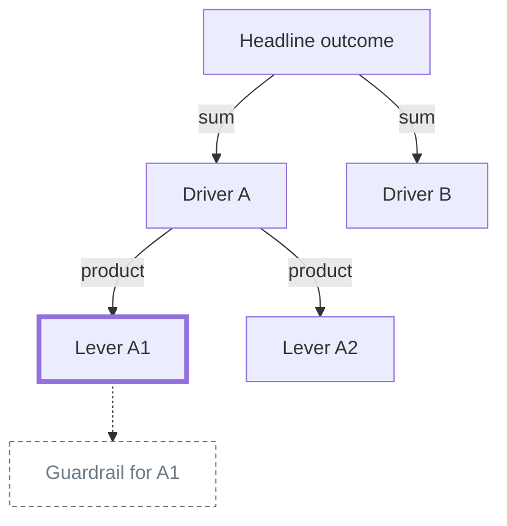

# KPIs

The KPIs the business is judged on, drawn as driver trees: one tree per
headline outcome, each node a link to the KPI's own page. The rules for the
trees are in [Maintaining the KPI driver tree](../../team/kpi-driver-tree.md).
Read a tree from the root down: the root is the outcome, the leaves are the
levers a team can move.

## Headline outcomes

*Add: the two or three outcomes the business is judged on, one sentence each,
matching [What this means for the team](../index.md#what-this-means-for-the-team)
on the overview.* Why: each one is the root of a tree below.

## Trees

*Add: one Mermaid tree per headline outcome, built from the `parent`, `edge`,
`guardrail_for`, and `has_loop` fields in `facts/kpis.yaml`. Every node links
to its KPI page with a `click` line. Replace the placeholder below.* Why: the
tree is the map from an outcome to the levers the team can move.

Legend: a solid edge is arithmetic and carries its operator (sum, product,
ratio); a dashed edge is causal, believed but not computed. A guardrail is
drawn in grey beside the driver it protects. A node with a double border has
a loop: a model or rule makes the decision that moves it.

## By category

*Add: the same KPIs listed by kind, revenue, cost, behavioural, risk, as a
second way in. Link each to its page.* Why: a reader who knows the metric's
name but not its place in the tree finds it here.

## Guardrails

*Add: each guardrail and the driver it protects, with one sentence on the
damage it catches.* Why: a driver optimised without its guardrail is how a
loop produces a measured win and a real loss.

## Pages

*No KPI pages yet. Start with the root of the first tree, then its direct
inputs. Each page uses the `kpi` template and has an entry in
`facts/kpis.yaml`.*
