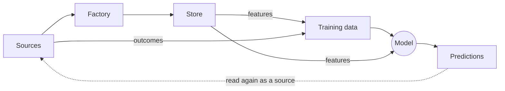

# Data

How data reaches a model, and what comes back from one. The section follows
a single chain, from the systems that record the business to the scores a
model writes, with one page for each stage.

The pages here say what each stage holds and what it promises. The rules for
building a table are on
[Conventions](../methods/development/conventions.md), and the systems that
store and move data are under [Technology](../technology/index.md).

## Source to score

Industries that own every step between a raw material and a customer have a
phrase for it: farm to fork, mine to market. The data a model reads moves
along the same kind of chain, and its stages already carry the names: a
source, a factory, a store. Here the chain runs from source to score.

| Stage | What it holds | What it promises |
|---|---|---|
| [Sources](sources/index.md) | The raw material: records as the business's systems wrote them | Only what its page says: grain, keys, timing, and how far to trust it |
| [Factory](factory.md) | Feature tables built from the sources | Every row says what was known and when, and a name means one thing |
| [Store](store.md) | The factory's tables, served by name | The same value for training and for scoring, as of any time asked |
| [Training data](training-data.md) | Labels, and the training sets that join them to features | A feature uses what was known at the decision time, a label what happened after it |
| [Predictions](predictions.md) | Every score a model wrote | A score traces to the model version and the features that produced it |

## Where the team's promises start

The team does not own most sources. They belong to the people who run the
business's systems, and they change on those people's schedules. A source
page records what a source does. It cannot promise what the source will do.

The team's own promises start at the factory. From there on, every table
keeps the contract on
[Conventions](../methods/development/conventions.md) and is tested as
[Testing](../methods/development/testing.md) requires. The factory is where
data someone else shaped for running the business becomes data the team
answers for.

## Traceable in both directions

The reason to run the chain as one thing is that any value can be traced
along it.

- **Back from a score.** A prediction names its model version and the
  features it read. A feature names the factory table it is served from. A
  factory table names the sources it reads.
- **Forward from a source.** A source page lists what is built from it, so a
  change at a source can be followed to the features, the models, and the
  decisions that will see it.

Sources are documented in this section. The factory and the store are
projects with their own documentation, and a model's training data and
predictions are documented in the model's repository. Each of those four
pages ends with a note saying what that documentation must carry, so that
the chain holds where it crosses from one repository to another.

## What is written where

| Question | Where |
|---|---|
| What is each stage for, and what does it promise? | Here |
| What does a source hold, what does it mean, and how far can it be trusted? | [Sources](sources/index.md) |
| Which tables and features exist, and what does each column mean? | The factory's and the store's own documentation |
| What are one model's label, training set, and output? | The model's repository, in its [data contracts](../methods/development/conventions.md#data-contracts) |
| How is a table named, keyed, timed, and tested? | [Conventions](../methods/development/conventions.md) and [Testing](../methods/development/testing.md) |
| What does the system that stores or moves it do, and what are its limits? | [Technology](../technology/index.md) |
| What happened on a date that changes how the data is read? | [Insights](../oversight/insights/index.md) |
| What was done with a prediction? | [Decision log](../oversight/decision-log.md) |

## Pages

- [Sources](sources/index.md): the raw material, what to know about a source
  before building on it, and how to read from one.
- [Factory](factory.md): the feature engineering between the sources
  and the store, and why it is a stage of its own.
- [Store](store.md): how features are served, and what the store does
  and does not do.
- [Training data](training-data.md): labels and training sets.
- [Predictions](predictions.md): the record of what every model
  scored.
