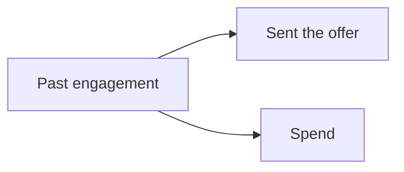
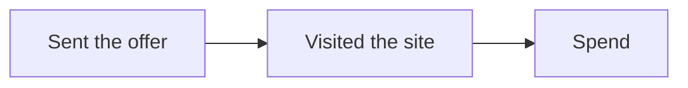
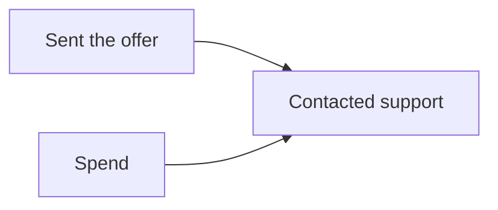
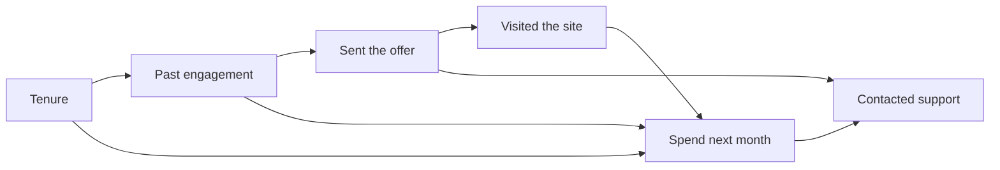

# Causal diagrams

A drawing of what is believed to cause what, made before the analysis, so
that the assumptions behind a causal estimate are on the page where a partner
can dispute them. It also answers a practical question that has no
statistical answer: which variables to adjust for and which to leave alone.

## What it is

A causal diagram is a set of variables joined by arrows, where an arrow from
one variable to another says the first has a direct effect on the second. It
is also called a directed acyclic graph, or DAG: directed because the arrows
point one way, acyclic because nothing can cause itself by following the
arrows round. The diagram is not estimated from data. It is a statement of
what the team and the people who know the business believe about how the
outcome comes about. Given the diagram, there are mechanical rules for
deciding whether the effect of an action on an outcome can be estimated from
the data at hand, and which variables must be adjusted for to do it. The
value is as much in the drawing as in the rules: the diagram makes
assumptions explicit that a regression leaves implied.

## When it is the right choice

- Before any analysis that will be read as causal and is not a randomized
  experiment.
- When choosing the covariates for [matching](matching.md) or for a
  [regression](regression.md) meant to adjust a comparison.
- When someone proposes to "control for everything available".
- When reviewing an analysis someone else did, to see what it assumed.
- With a business partner, as a way to collect what they know about why
  customers get treated and why outcomes move.

## When it is not

- **A randomized experiment, analysed as randomized.** Random assignment
  removes every arrow into the action. A diagram is still useful if the
  analysis conditions on anything that happened after assignment.
- **A prediction problem.** A model built to predict does not need its inputs
  to be causes. See
  [framing and evaluating a prediction](framing-and-evaluating-a-prediction.md).
- **As a substitute for a design.** If the diagram has an unmeasured common
  cause of the action and the outcome, no choice of adjustment fixes it. The
  diagram's job is then to say so.

## Assumptions

The diagram is itself the list of assumptions. Reading it that way:

| Assumption | What it means | How it is checked |
|---|---|---|
| Every missing arrow is a claim | Two variables with no arrow between them have no direct effect on each other | Reviewed with people who know the process. Some missing arrows imply that two variables are unrelated once others are held fixed, which can be tested in the data |
| Every common cause is on the diagram | Anything that affects two variables on the diagram is drawn, including things that are not measured | Cannot be checked from data. Drawn as an unmeasured variable when suspected |
| The arrows follow time | A cause comes before its effect. Feedback is drawn by splitting a variable by period | Check the date each variable was fixed |
| The variables are what they are named | A measured stand-in for the real cause adjusts for it only partly | Named honestly: "past spend", not "loyalty" |

The diagram says nothing about how large an effect is, its sign, or its
form. That is the job of the estimate.

## The three structures

Every path in a diagram is built from three patterns, and each behaves
differently when a variable is adjusted for. Adjusting for a variable means
holding it fixed: including it in a regression, matching on it, or analysing
only one value of it.

**A common cause.** The third variable causes both the action and the
outcome.

Engaged customers are sent the offer and would have spent more anyway. The
action and the outcome move together with no effect of one on the other.
This is confounding. **Adjust for it.**

**A step on the way.** The action causes the third variable, which causes
the outcome.

The visit is how the offer works. Adjusting for it removes the part of the
effect that flows through it. If all of the effect flows through it, the
offer appears to do nothing. Such a
variable is called a mediator. **Do not adjust for it** when the question is
the whole effect of the action.

**A common effect.** The action and the outcome both cause the third
variable.

Customers contact support because the offer confused them, or because they
ordered something. Among customers who contacted support, those who were not
sent the offer are more likely to be there because they spent. Holding the
contact fixed creates a relationship between offer and spend that is not
there in the whole base. Such a variable is called a collider. **Do not
adjust for it,** and do not restrict the analysis to one of its values.

The third is the least intuitive and the most often broken. Any analysis
restricted to customers who did something afterwards, such as opened,
responded, purchased, or stayed, has conditioned on a common effect if the
action and the outcome both influence that something. This is selection
bias.

## What to adjust for

Put the three together for one question: did the offer raise spend?

The rules, in plain words:

1. **List every path between the action and the outcome that starts with an
   arrow pointing into the action.** These are the ways the two can be
   related without the action having any effect. Here: offer, past
   engagement, spend; and offer, past engagement, tenure, spend.
2. **Block each of those paths** by adjusting for a variable on it that is
   not a common effect. Adjusting for past engagement blocks both. A path
   that passes through a common effect is closed as it stands and needs
   nothing, so long as the common effect is left alone.
3. **Leave alone anything the action causes.** Not the visit, not the support
   contact, nor anything downstream of them.
4. **Check that no adjustment has opened a new path** by holding a common
   effect fixed. For each variable adjusted for, ask whether two other
   variables on the diagram both point into it, or into something that
   causes it.

These rules are known as the back-door criterion. Whether a path is open or
closed is called d-separation, and a set of variables that closes every such
path is an adjustment set.

Here the answer is: adjust for past engagement. Tenure is optional. The site
visit and the support contact are left out even though both are strongly
related to spend and would improve the fit of a model.

The useful general rule: adjust for things fixed before the action that
affect both who got it and the outcome. Do not adjust for anything measured
after the action. A variable's power to predict the outcome is not on its
own a reason to include it. One fixed before the action that predicts the
outcome may be included to sharpen the estimate. One measured after the
action may not.

If a common cause is not measured, such as a salesperson's judgment of which
accounts were worth an offer, no adjustment blocks its path. The diagram has
then shown that this data cannot answer the question, and the options are an
[experiment](experiments-and-lift-tests.md) or a design that does not rely on
adjustment: see
[measuring impact without an experiment](measuring-impact-without-an-experiment.md).

## Drawing one

1. Write the action and the outcome, with an arrow between them and a
   question mark on it.
2. Ask how units came to get the action. Who decided, using what? Each
   answer is a variable with an arrow into the action.
3. Ask what else moves the outcome. Each answer is a variable with an arrow
   into the outcome.
4. For each pair of variables now on the page, ask whether one affects the
   other and whether anything not yet drawn affects both.
5. Add what the action sets off on its way to the outcome, and anything the
   analysis will filter or group by.
6. Mark each variable as measured or not, and with the date it is fixed.
7. Take it to someone who runs the process and ask what is missing. Their
   additions are the point of the exercise.

Keep it to the variables that matter for the question. A diagram with forty
nodes has stopped being a tool for argument.

## Common approaches

| Approach | What it needs | What it rests on | Main weakness |
|---|---|---|---|
| Drawn from knowledge of the business, before the analysis | People who know how the action was assigned and what drives the outcome | Their knowledge being right and complete | Cannot be confirmed from data. Two reasonable people draw different diagrams |
| Reconstructed from an analysis already done | The list of variables the analysis adjusted for and filtered on | That the analyst's choices can be read as claims | Shows what was assumed, after the fact |
| Checked against data | A diagram and the data | That the relationships the diagram says should be absent can be tested: two variables with no arrow between them should be unrelated once the variables that close every path between them are held fixed | Many different diagrams imply the same absences, so passing proves little. Failing is informative |
| Learned from data by a search algorithm | A large dataset with every relevant variable measured | Strong conditions, including no unmeasured common causes | Returns a set of diagrams the data cannot tell apart, and is fragile in practice. A source of suggestions, not of conclusions |

The first is the method. The second is how to review someone else's work.
The third is a check worth running. Treat the fourth with caution.

## Reading a result you did not produce

Questions to ask of an analysis that says it "controlled for" other factors.

- **What was adjusted for, and when was each variable fixed?** Sort the list
  into before the action and after it. Anything after is suspect.
- **Is any control a step on the way from action to outcome?** Controlling
  for site visits when measuring an email, or for the number of orders when
  measuring an effect on revenue, removes part or all of the effect being
  measured.
- **Was the sample filtered on something that happened afterwards?** Only
  customers who opened, who responded, who were still active at the end.
  Each is a possible common effect.
- **What decided who got the action?** If the answer is a person's judgment
  or a targeting model, ask whether what they used is in the data. If it is
  not, no list of controls is enough.
- **Is a control standing in for something broader?** A flag for "has the
  app" does not adjust for engagement.
- **Are the coefficients on the controls being interpreted?** A model built
  to estimate the effect of one action says nothing reliable about the
  effect of the variables it adjusted for. See
  [regression](regression.md#pitfalls).
- **Was the list of controls chosen before or after seeing the result?** A
  result that appears only under one set of controls is a property of that
  set.

Drawing the diagram the analysis implies, and showing it to its author, is
usually the quickest review.

## Where it applies to our data

*Add: the diagrams the team has drawn for its recurring causal questions,
each with the date, who reviewed it, and which variables are unmeasured.*
Why: the same questions come back, and a reviewed diagram is the starting
point for the next analysis.

*Add: how each action the business takes on customers is assigned: by rule,
by model, by a person's choice.* Why: the arrows into the action decide
whether an observational analysis is possible at all.

## Lessons learned

None recorded yet.

## Reference implementations

None yet.

## Further reading

Pearl, Judea, Madelyn Glymour, and Nicholas P. Jewell. *Causal Inference in
Statistics: A Primer.* Wiley, 2016. The shortest full treatment of diagrams,
paths, and the rules for adjustment. Start here.

Cinelli, Carlos, Andrew Forney, and Judea Pearl. "A Crash Course in Good and
Bad Controls." *Sociological Methods & Research* 53, no. 3 (2024):
1071–1104. A catalogue of small diagrams, each showing whether a control
helps, harms, or does nothing. The most useful single paper for deciding what
to adjust for.

Hernán, Miguel A., and James M. Robins. *Causal Inference: What If.* Chapman
& Hall/CRC, 2020. The chapters on graphical representation, confounding, and
selection bias tie the diagrams to the counterfactual definitions.

Greenland, Sander, Judea Pearl, and James M. Robins. "Causal Diagrams for
Epidemiologic Research." *Epidemiology* 10, no. 1 (1999): 37–48. The paper
that brought diagrams into applied work.

Hernán, Miguel A., Sonia Hernández-Díaz, and James M. Robins. "A Structural
Approach to Selection Bias." *Epidemiology* 15, no. 5 (2004): 615–625.
Selection bias as conditioning on a common effect, with many examples.

Pearl, Judea. "Causal Diagrams for Empirical Research." *Biometrika* 82, no.
4 (1995): 669–688. The original statement of the rules.

Textor, Johannes, Benito van der Zander, Mark S. Gilthorpe, Maciej Liśkiewicz,
and George T. H. Ellison. "Robust Causal Inference Using Directed Acyclic
Graphs: The R Package 'dagitty'." *International Journal of Epidemiology* 45,
no. 6 (2016): 1887–1894. A free tool for drawing a diagram and listing the
adjustment sets and testable implications it implies.
