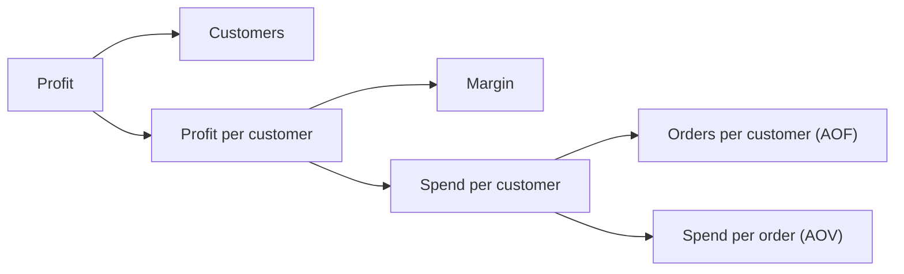

# Customer-base audit

A structured description of a company's customers, built from its transaction
records: how customers differ from one another, how their buying changes over
time, and what that says about the health of the business. This page is the
framework. What it found when applied to this business is on the
[customer-base audit report](../business/customer-base-audit.md).

## What it is

A descriptive analysis that reads revenue and profit by customer instead of by
product. Most reporting asks how much each product sold in each period. The
audit asks who bought, how often, for how much, and whether the same people
came back. It answers with five standard views of the same data, called
lenses, each a different slice through a table of customers by time. It uses
counts, averages, distributions, and ratios only. It fits no model and makes
no forecast, which is why it comes first: it shows what any later model of
customer value, churn, or response has to explain.

## Defining the customer

Every count, cohort, and repeat rate in the audit rests on what a customer is.
The definition is settled before any lens is applied, and it is harder than
it seems because the data records identifiers, not customers.

Start from the definitions the business already has. Finance, marketing,
customer service, and the warehouse's own customer table each usually carry
one, and they rarely agree. Collect them, see where they differ, and derive
the audit's definition from them. Do not invent a new one beside them. The
choice is made on these points:

- **The unit.** A person, a household, an account, or a business. The one who
  pays and the one who uses can be different people. Choose the unit the
  business makes decisions about.
- **The identifier is a stand-in.** One customer can hold several identifiers:
  more than one card, email address, or account, or a guest checkout beside a
  registered one. One identifier can cover several customers, as a shared
  account does. Say which identifier is used, what is merged, and by what
  rule.
- **Coverage.** Some sales carry no identifier: cash, guest checkout, sales
  through an intermediary. The audit describes only the identified part of
  the business. State the part as a share of revenue and what is known
  about the rest.
- **When someone becomes a customer.** At the first purchase, or earlier, at
  registration or a trial. Customers whose first purchase is older than the
  data cannot be placed in a true cohort. Keep them as one group of their
  own, as the book does, and do not let them pass as newly acquired.
- **What is left out.** Staff and internal accounts, test orders, resellers,
  and how returns and cancelled orders are counted.

The definition of a customer shapes what every lens shows.

Where one customer is split across identifiers, the audit finds too many
one-time buyers and too many new customers, and repeat buying looks weaker than
it is. Where several customers share an identifier, it finds the reverse: fewer,
heavier customers and repeat buying that looks stronger than it is. Neither
error is visible in the output, so the definition is stated on every output,
with the share of revenue it covers.

Keep the definition of a customer fixed from one audit to the next. A change to
it is a break in every series, not a change in the customers, and is recorded as
one.

## Assembling the data

The audit needs a transaction record in which every purchase carries the
customer identifier chosen above. Three dimensions describe every row: the
customer, the time, and the product. Standard reporting
collapses the customer dimension and looks at product by time. The audit
collapses the product dimension and looks at customer by time.

Two summaries of the transaction record carry almost all the analysis.

| Table | One row per | Holds |
|---|---|---|
| Transaction record | Item on an order | Order, customer, date, product, quantity, price |
| Order summary | Order | Customer, date, spend, profit |
| Customer-period summary | Customer and period | Number of orders, total spend, total profit |

Two more definitions are fixed before any lens is applied, and stated on
every output:

- **The period.** A year, a quarter, or a month. Short periods show seasonality
  and need more history; long periods hide it.
- **The cohort.** The customers whose first purchase fell in the same period.
  A customer belongs to one cohort forever.

Profit needs a cost for each item sold. Where cost is not available, the audit
is run on spend, and the margin component below is dropped.

## The five lenses

Lay the customer-period summary out as a grid: one row per cohort, one column
per period. A cohort has no cells before the period it was acquired in, so the
grid is a staircase. Each lens is a slice of that grid.

*Each row is a cohort, by period of first purchase. Each column is a period.
Redrawn from the framework in Fader, Hardie, and Ross (2022).*

| | Looks down a period | Looks along a cohort |
|---|---|---|
| **One** | Lens 1: how customers differ within a period | Lens 3: how a cohort behaves as it ages |
| **Two** | Lens 2: what changed between two periods | Lens 4: how one cohort compares with another |
| **All** | Lens 5: how the cohorts add up to the whole, period by period | |

### Lens 1: one period

**The question.** How different are the customers who bought in this period?

**What it produces.**

- The distribution, across customers, of total spend, number of orders,
  average spend per order, profit, and margin. Each with its mean and median.
- A decile table, built two ways. Rank customers by profit and cut them into
  ten groups of equal size, to see the share of profit each tenth of customers
  brings. Then cut them into ten groups of equal profit, to see how few
  customers make up the top tenth of profit and how many make up the bottom.
- The [profit decomposition](#the-profit-decomposition) for each decile.

**What to look for.** How concentrated profit is. How far the mean sits above
the median, which says how misleading "the average customer" is. The share of
customers who bought once. Whether the best customers are best because they
order more often, spend more per order, or buy at a better margin. Customers
whose profit is below zero.

### Lens 2: two periods

**The question.** What changed between one period and the next, and which
customers changed it?

**What it produces.**

- The Lens 1 distributions for both periods, side by side.
- Customers split into three groups: those who bought in the first period
  only, in both, and in the second period only. The change in profit is then
  the profit from the third group, less the profit that left with the first,
  plus the change among the customers in both.
- The decomposition for each group in each period.
- A table of movement between deciles: where the customers of each decile in
  the first period sit in the second.
- For customers in both periods, a count by direction of change: profit up or
  down, and whether order count, spend per order, and margin each rose or
  fell.

**What to look for.** Distributions that look the same in both periods while
the customers inside them are largely different people. Growth that comes
entirely from the customers who are new to the period while the customers
present in both spend less. Which component moved among the customers who
stayed. A customer missing from the second period has not necessarily left
for good, and a customer missing from the first is not necessarily new: only
the cohort lenses can say.

### Lens 3: one cohort

**The question.** How does a group of customers acquired together behave as it
ages?

**What it produces.**

- The cohort's revenue or profit in each period since acquisition, with first
  purchases separated from repeat purchases.
- The decomposition over time: the share of the cohort active in each period,
  and the orders, spend per order, and margin of those who were active.
- The patterns of activity across periods: how many bought in every period,
  in the first only, or skipped a period and came back.
- Time to second purchase, per period and cumulative, and the time between
  each later pair of purchases.
- Value to date: each customer's total profit since acquisition, its
  distribution across the cohort, and deciles of it.
- A summary by recency, frequency, and value.

**What to look for.** How steeply the cohort falls after its acquisition
period and where it levels off. The share of the cohort that never makes a
second purchase. How quickly customers who will be valuable show it. Where
customers buy without a contract, the share active in a period is not a
retention rate: customers skip periods and return, so a customer who is
inactive has not been lost.

### Lens 4: two cohorts

**The question.** Are the customers acquired at one time better or worse than
those acquired at another?

**What it produces.** The Lens 3 outputs for two cohorts on the same axes,
aligned two ways:

- **By calendar period.** A movement both cohorts make in the same calendar
  period is something that happened to the business: a season, a price change,
  a promotion.
- **By age,** in periods since acquisition. A movement both cohorts make at
  the same age is how customers of this business mature.

Sizes differ between cohorts, so values are also indexed to each cohort's
acquisition period. Two pairings are standard: adjacent cohorts, which
differ in the season or campaign that acquired them, and cohorts a year apart,
which share a season and differ in when the business acquired them.

**What to look for.** Whether newer cohorts are as active, at the same age, as
older ones were. Whether customers acquired in a peak season or by a heavy
promotion behave differently afterwards. Which component carries any
difference.

### Lens 5: the whole base

**The question.** How do the cohorts add up to the business's total, and how
much of each period depends on customers acquired in it?

**What it produces.**

- Each period's revenue, profit, and active customers, split by cohort.
- The number of customers acquired in each period.
- Each cohort's share of each period's total, and how much of its value in
  one period it kept in the next.
- Repeat buying by cohort, at the same age.
- The decomposition by cohort across periods.

**What to look for.** The share of each period's profit that comes from
customers acquired in that period: a business that must replace most of its
profit with new customers every period is growing differently from one whose
older cohorts hold. Whether growth in the total comes from larger cohorts,
from cohorts that keep more, or from neither. Totals that are steady while the
mix beneath them shifts.

## The profit decomposition

Every lens reads its totals through the same breakdown. Each split is a
product: the two boxes on the right multiply to give the box on the left.

AOF is average order frequency and AOV is average order value. Within a
cohort the number of customers splits once more, into the size of the cohort
and the share of it active in the period. A change in any total can be
attributed to these components, and the same total can hide components moving
in opposite directions.

## Extensions

**The product dimension.** Bringing products back in asks what the customers
in each decile buy: how many categories, how many items per order, at what
price. For each category it gives the share of customers who buy in it and
its own order frequency, order value, and margin. It shows which categories
are bought together, and whether the category of a customer's first purchase
says anything about their later value.

**Contractual businesses.** Where customers subscribe, cancellation is
observed, so a cohort has a survival curve, the share still subscribed at each
tenure, and a retention rate at each tenure. The retention rate of a cohort
usually rises with tenure, as the customers most likely to leave do so first.
The retention rate of the whole base is therefore an average over cohorts of
different tenures. It rises as the base ages and is lower the faster
acquisition grows, with no change in how any customer behaves. Read retention
by cohort.

## Where it applies to our data

*Add: the definitions of a customer already in use in the business, where
each one is written down, and the one the audit uses, with the reason.* Why:
the audit's definition is derived from what exists, and a reader needs to
know how its counts relate to the ones they already see.

*Add: the transaction datasets the audit can run on, linked to their pages
under Data, with the customer identifier each one carries and how far back it
is reliable.* Why: the audit is only as good as the identifier that ties a
customer's purchases together.

*Add: the period and cohort definitions the team has settled on, and whether
profit or spend is the measure.* Why: every output depends on them, and two
audits with different definitions cannot be compared.

The findings are on the
[customer-base audit report](../business/customer-base-audit.md).

## When it is the right choice

- As the first analysis of a business, a product line, or a market the team
  has not worked on before.
- Before building a model of customer value, churn, or response, to see the
  patterns the model must reproduce.
- When a headline number has moved and nobody can say which customers moved
  it.
- On a schedule, as a report on the state of the customer base.

## When it is not

- **No persistent customer identifier.** Anonymous transactions cannot be
  tied together, and every lens depends on that. Where only part of revenue
  is identified, the audit describes that part and nothing more.
- **A causal question.** The audit says what happened and to whom. It does not
  say why, or what an action would have changed.
- **A forecast.** It describes the periods it has. Projecting a cohort forward
  is a modelling task.
- **Too little history.** Lens 1 needs one period. The cohort lenses need
  enough periods for a cohort to age.
- **Very few customers.** Distributions and deciles of a few dozen accounts
  say little. Read the accounts one by one.

## Lessons learned

None recorded yet.

## Reference implementations

None yet.

## Source

Fader, Peter S., Bruce G. S. Hardie, and Michael Ross. *The Customer-Base
Audit: The First Step on the Journey to Customer Centricity.* Wharton School
Press, 2022. The framework, the five lenses, and the terms AOF, AOV, and value
to date are theirs. The diagrams on this page are redrawn and carry none of
the book's data. The book works each lens through in full on a single
retailer's data and is the place to go for the analyses in detail.
