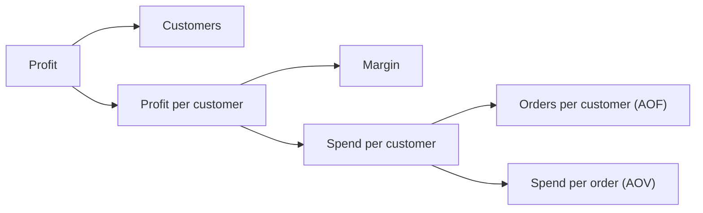

# Customer-base audit

A structured description of a company's customers, built from its transaction
records: how customers differ from one another, how their buying changes over
time, and what that says about the health of the business.

!!! note

    This page covers the customer-base audit framework. See the 
    [customer-base audit report](../business/customer-base-audit.md) for the
    results of the audit when applied to this business.

## What it is

A descriptive analysis that reads revenue and profit by customer instead of by
product. Most reporting asks how much each product sold in each period. The
audit asks who bought, how often, for how much, and whether the same people
came back.

The analysis uses five standard views of the same data, called lenses, each a
different slice through a table of customers by time. It uses counts, averages,
distributions, and ratios only. It fits no model and makes no forecast, which is
why it comes first: it shows what any later model of customer value, churn, or
response has to explain.

## When it is the right choice

- As the first analysis of a business, a product line, or a market the team
  has not worked on before.
- Before building a model of customer value, churn, or response, to see the
  patterns the model must reproduce.
- When a headline number has moved and nobody can say which customers moved
  it.
- On a schedule, as a report on the state of the customer base.

## When it is not

- **No persistent customer identifier.** Anonymous transactions cannot be
  tied together, and every lens depends on that. Where only part of revenue
  is identified, the audit describes that part and nothing more.
- **A causal question.** The audit says what happened and to whom. It does not
  say why, or what an action would have changed.
- **A forecast.** It describes the periods it has. Projecting a cohort forward
  is a modelling task.
- **Too little history.** Lens 1 needs one period. The cohort lenses need
  enough periods for a cohort to age.
- **Very few customers.** Distributions and deciles of a few dozen accounts
  say little. Read the accounts one by one.

## Defining the customer

Every count, cohort, and repeat rate in the audit rests on what the definition
of a customer is. The definition must be settled before any lens is applied, and
it is harder than it seems because the data records identifiers, not customers.

Start from the definitions the business already has. Finance, marketing,
customer service, and the warehouse's own customer table each usually carry
one, and they rarely agree. Collect them, see where they differ, and derive
the audit's definition from them. Do not invent a new one beside them. The
choice is made on these points:

- **The unit.** A person, a household, an account, or a business. The one who
  pays and the one who uses can be different people. Choose the unit the
  business makes decisions about.
- **The identifier is a stand-in.** One customer can hold several identifiers:
  more than one card, email address, or account, or a guest checkout beside a
  registered one. One identifier can cover several customers, as a shared
  account does. Say which identifier is used, what is merged, and by what
  rule.
- **Coverage.** Some sales carry no identifier: cash, guest checkout, sales
  through an intermediary. The audit describes only the identified part of
  the business. State the part as a share of revenue and what is known
  about the rest.
- **When someone becomes a customer.** At the first purchase, or earlier, at
  registration or a trial. Customers whose first purchase is older than the
  data cannot be placed in a true cohort. Keep them as one group of their
  own, as the book does, and do not let them pass as newly acquired.
- **What is left out.** Staff and internal accounts, test orders, resellers,
  and how returns and canceled orders are counted.

The definition of a customer shapes what every lens shows.

Where one customer is split across identifiers, the audit finds too many
one-time buyers and too many new customers, and repeat buying looks weaker than
it is. Where several customers share an identifier, it finds the reverse: fewer,
heavier customers and repeat buying that looks stronger than it is. Neither
error is visible in the output, so the definition is stated on every output,
with the share of revenue it covers.

Keep the definition of a customer fixed from one audit to the next. A change to
it is a break in every series, not a change in the customers, and is recorded as
one.

## Assembling the data

The audit needs a transaction record in which every purchase carries the
customer identifier chosen above. Three dimensions describe every row: the
customer, the time, and the product. Standard reporting
collapses the customer dimension and looks at product by time. The audit
collapses the product dimension and looks at customer by time.

Two summaries of the transaction record carry almost all the analysis.

| Table | One row per | Holds |
|---|---|---|
| Transaction record | Item on an order | Order, customer, date, product, quantity, price |
| Order summary | Order | Customer, date, spend, profit |
| Customer-period summary | Customer and period | Number of orders, total spend, total profit |

Two more definitions are fixed before any lens is applied, and stated on
every output:

- **The period.** A year, a quarter, or a month. Short periods show seasonality
  and need more history; long periods hide it.
- **The cohort.** The customers whose first purchase fell in the same period.
  A customer belongs to one cohort forever.

Profit needs a cost for each item sold. Where cost is not available, the audit
is run on spend, and the margin component below is dropped.

### Table contracts

Each table is built from the one above it and from nothing else, so the
totals can be checked against each other.

Transaction record

:   One row per item on an order. Columns: order identifier, customer
    identifier, order date, product identifier, quantity, price paid for each
    unit, and cost of each unit where profit is used. The customer identifier
    is the one left after the merging rule in the customer definition, and
    the rows that definition leaves out are already removed. Say what the
    price includes: discounts, tax, and delivery charges. Say how a return
    appears: as a row with a negative quantity, or not at all.

Order summary

:   One row per order. Columns: order identifier, customer identifier, order
    date, spend, and profit. Spend is quantity times price, summed over the
    order's items. Profit is spend less quantity times cost, summed the same
    way. A return is not an order: it reduces spend and profit and adds
    nothing to the count of orders. Say whether two orders by one customer on
    the same day count as one.

Customer-period summary

:   One row per customer and period in which the customer placed at least one
    order. Columns: customer identifier, period, cohort, number of orders,
    total spend, and total profit. The cohort is the period of the customer's
    earliest order in the order summary and is the same on every row for that
    customer. There is no row for a period in which the customer did not buy.
    An inactive customer is absent from the period, not a row of zeros, so
    any share of a cohort is divided by the size of the cohort and not by the
    number of rows.

Two more values are kept for each customer, for the cohort lenses: the date
of the first order, and whether that order is older than the start of the
data. Customers for whom it is form the group with no true cohort.

## The five lenses

Lay the customer-period summary out as a grid: one row per cohort, one column
per period. A cohort has no cells before the period it was acquired in, so the
grid is a staircase. Each lens is a slice of that grid.

*Each row is a cohort, by period of first purchase. Each column is a period.
Redrawn from the framework in Fader, Hardie, and Ross (2022).*

| | Looks down a period | Looks along a cohort |
|---|---|---|
| **One** | Lens 1: how customers differ within a period | Lens 3: how a cohort behaves as it ages |
| **Two** | Lens 2: what changed between two periods | Lens 4: how one cohort compares with another |
| **All** | Lens 5: how the cohorts add up to the whole, period by period | |

### Lens 1: one period

**The question.** How different are the customers who bought in this period?

**What it produces.**

- The distribution, across customers, of total spend, number of orders,
  average spend per order, profit, and margin. Each with its mean and median.
- A decile table, built two ways. Rank customers by profit and cut them into
  ten groups of equal size, to see the share of profit each tenth of customers
  brings. Then cut them into ten groups of equal profit, to see how few
  customers make up the top tenth of profit and how many make up the bottom.
- The [profit decomposition](#the-profit-decomposition) for each decile.

**What to look for.** How concentrated profit is. How far the mean sits above
the median, which says how misleading "the average customer" is. The share of
customers who bought once. Whether the best customers are best because they
order more often, spend more per order, or buy at a better margin. Customers
whose profit is below zero.

### Lens 2: two periods

**The question.** What changed between one period and the next, and which
customers changed it?

**What it produces.**

- The Lens 1 distributions for both periods, side by side.
- Customers split into three groups: those who bought in the first period
  only, in both, and in the second period only. The change in profit is then
  the profit from the third group, less the profit that left with the first,
  plus the change among the customers in both.
- The decomposition for each group in each period.
- A table of movement between deciles: where the customers of each decile in
  the first period sit in the second.
- For customers in both periods, a count by direction of change: profit up or
  down, and whether order count, spend per order, and margin each rose or
  fell.

**What to look for.** Distributions that look the same in both periods while
the customers inside them are largely different people. Growth that comes
entirely from the customers who are new to the period while the customers
present in both spend less. Which component moved among the customers who
stayed. A customer missing from the second period has not necessarily left
for good, and a customer missing from the first is not necessarily new: only
the cohort lenses can say.

### Lens 3: one cohort

**The question.** How does a group of customers acquired together behave as it
ages?

**What it produces.**

- The cohort's revenue or profit in each period since acquisition, with first
  purchases separated from repeat purchases.
- The decomposition over time: the share of the cohort active in each period,
  and the orders, spend per order, and margin of those who were active.
- The patterns of activity across periods: how many bought in every period,
  in the first only, or skipped a period and came back.
- Time to second purchase, per period and cumulative, and the time between
  each later pair of purchases.
- Value to date: each customer's total profit since acquisition, its
  distribution across the cohort, and deciles of it.
- A summary by recency, frequency, and value: see
  [RFM analysis](rfm-analysis.md).

**What to look for.** How steeply the cohort falls after its acquisition
period and where it levels off. The share of the cohort that never makes a
second purchase. How quickly customers who will be valuable show it. Where
customers buy without a contract, the share active in a period is not a
retention rate: customers skip periods and return, so a customer who is
inactive has not been lost.

### Lens 4: two cohorts

**The question.** Are the customers acquired at one time better or worse than
those acquired at another?

**What it produces.** The Lens 3 outputs for two cohorts on the same axes,
aligned two ways:

- **By calendar period.** A movement both cohorts make in the same calendar
  period is something that happened to the business: a season, a price change,
  a promotion.
- **By age,** in periods since acquisition. A movement both cohorts make at
  the same age is how customers of this business mature.

Sizes differ between cohorts, so values are also indexed to each cohort's
acquisition period. Two pairings are standard: adjacent cohorts, which
differ in the season or campaign that acquired them, and cohorts a year apart,
which share a season and differ in when the business acquired them.

**What to look for.** Whether newer cohorts are as active, at the same age, as
older ones were. Whether customers acquired in a peak season or by a heavy
promotion behave differently afterwards. Which component carries any
difference.

### Lens 5: the whole base

**The question.** How do the cohorts add up to the business's total, and how
much of each period depends on customers acquired in it?

**What it produces.**

- Each period's revenue, profit, and active customers, split by cohort.
- The number of customers acquired in each period.
- Each cohort's share of each period's total, and how much of its value in
  one period it kept in the next.
- Repeat buying by cohort, at the same age.
- The decomposition by cohort across periods.

**What to look for.** The share of each period's profit that comes from
customers acquired in that period: a business that must replace most of its
profit with new customers every period is growing differently from one whose
older cohorts hold. Whether growth in the total comes from larger cohorts,
from cohorts that keep more, or from neither. Totals that are steady while the
mix beneath them shifts.

## The profit decomposition

Every lens reads its totals through the same breakdown. Each split is a
product: the two boxes on the right multiply to give the box on the left.

AOF is average order frequency and AOV is average order value. Within a
cohort the number of customers splits once more, into the size of the cohort
and the share of it active in the period. A change in any total can be
attributed to these components, and the same total can hide components moving
in opposite directions.

Each component is defined for a group of customers in a period. The group can
be everyone, a decile, or a cohort.

| Component | Definition |
|---|---|
| Customers | Customers in the group with at least one order in the period |
| Orders, spend, profit | Totals over those customers in the period |
| Profit per customer | Profit ÷ customers |
| Spend per customer | Spend ÷ customers |
| Margin | Profit ÷ spend |
| Orders per customer (AOF) | Orders ÷ customers |
| Spend per order (AOV) | Spend ÷ orders |
| Share active, within a cohort | Customers ÷ size of the cohort |

So profit is customers × AOF × AOV × margin, and within a cohort customers is
the size of the cohort × the share active.

Each component of a group is a ratio of the group's totals. It is not the
average of the same ratio worked out customer by customer. The two differ:
the average of each customer's spend per order gives a customer with one
order the same weight as a customer with twenty, and the components then no
longer multiply back to the total. The customer-by-customer values belong in
the Lens 1 distributions, not in the decomposition.

When a total changes between two periods, show the components for both
periods side by side. Splitting the change into an amount due to each
component depends on the order in which the components are swapped from the
old value to the new, so where one split is reported, say how it was made.

## Extensions

**The product dimension.** Bringing products back in asks what the customers
in each decile buy: how many categories, how many items per order, at what
price. For each category it gives the share of customers who buy in it and
its own order frequency, order value, and margin. It shows which categories
are bought together, and whether the category of a customer's first purchase
says anything about their later value.

**Contractual businesses.** Where customers subscribe, cancellation is
observed, so a cohort has a survival curve, the share still subscribed at each
tenure, and a retention rate at each tenure. The retention rate of a cohort
usually rises with tenure, as the customers most likely to leave do so first.
The retention rate of the whole base is therefore an average over cohorts of
different tenures. It rises as the base ages and is lower the faster
acquisition grows, with no change in how any customer behaves. Read retention
by cohort.

**Following up.** The audit says where the customer base is strong or weak.
It does not say where along a customer's path the weakness arises or why.
[Funnel analysis](funnel-analysis.md) takes an acquisition, retention, or
development question the audit has raised and finds the step at which
customers are lost. [Survival analysis](survival-analysis.md) is the full
treatment of the time-to-event outputs in Lens 3.
[Decomposing a change](decomposing-a-change.md) generalises the profit
decomposition to any number and any segmentation.

## Building the outputs

The lenses above say what each output is for. This section is the contract
for building them: what each one is built from, its rows and columns, and the
form it is shown in. Each table below lists the outputs of one lens.

Deciles are numbered from 1, the highest profit, to 10. Ties at a boundary
are broken by a fixed rule, such as the customer identifier, so that a rerun
gives the same groups.

### Lens 1 outputs

Built from the customer-period summary for one period.

| Output | Rows | Columns | Shown as |
|---|---|---|---|
| Distribution of a measure | Bands of the measure | Customers, share of customers | Histogram, with the mean and median marked |
| Deciles of equal size | The ten deciles | Customers, profit, share of profit, cumulative share, and each component | Table |
| Deciles of equal profit | The ten tenths of profit | Customers, share of customers | Table |

The measures for each customer are orders, spend, spend per order (spend ÷
orders), profit, and margin (profit ÷ spend). The distributions have a long
right tail. Close the top band, as in "ten orders or more", and say where it
was closed.

For deciles of equal profit, rank customers from the highest profit down,
add up profit along the ranking, and cut each time the running total passes
another tenth of the period's profit. Customers with profit below zero break
this: the running total passes the whole and falls back. Report them as a
group of their own, with their number and their total loss, and build both
decile tables on the rest. Say that this was done.

The share of customers who bought once is the number with one order in the
period ÷ customers. It is once in the period, not once ever.

### Lens 2 outputs

Built from the customer-period summary for two periods. Choose two that can
be compared: the same length, both complete, and the same season where the
business has one.

| Output | Rows | Columns | Shown as |
|---|---|---|---|
| Distributions | As Lens 1 | One series for each period | Two histograms on the same bands |
| Three groups | First period only, both, second period only | Customers, profit in each period, change, and each component in each period | Table |
| Movement between deciles | Decile in the first period, and a row for not active | Decile in the second period, and a column for not active | Table of counts, with each row also as shares |
| Direction of change | Each combination of orders, spend per order, and margin up or down | Customers, change in profit | Table |

The change in profit between the periods is:

- profit in the second period from customers in the second period only,
- less profit in the first period from customers in the first period only,
- plus profit in the second period less profit in the first, among customers
  in both.

Deciles in the movement table are cut for each period on its own. Direction
of change covers customers in both periods only. A measure that did not move
is counted as unchanged, not as up or down.

### Lens 3 outputs

Built from the order summary and the customer-period summary for one cohort.
Age is counted in periods since acquisition, and the acquisition period is
age 0.

| Output | Rows | Columns | Shown as |
|---|---|---|---|
| Cohort over time | Age | Customers, share active, orders, spend, profit, and each component, with spend and profit split into first and repeat | Line for each measure |
| Patterns of activity | Each pattern of active and inactive periods | Customers, share of the cohort | Table, the largest patterns first |
| Time to second purchase | Time since first purchase, in bands | Customers making their second purchase in the band, cumulative share of the cohort | Bars for each band, line for the cumulative share |
| Value to date | As the Lens 1 distribution and deciles | Profit since acquisition for each customer | Histogram and decile table |

A first purchase is the customer's earliest order. Every later order is a
repeat purchase, including a second order inside the acquisition period.

With many periods the number of patterns is large. Show the largest, and
group the rest by the number of periods active.

Time to second purchase is counted from the date of the first order to the
date of the second, from the order summary. The cumulative share is divided
by the whole cohort, including customers with no second order. Value to date
is stated with the date it runs to.

### Lens 4 outputs

The Lens 3 cohort-over-time and time-to-second-purchase outputs, for two
cohorts.

| Output | Rows | Columns | Shown as |
|---|---|---|---|
| By calendar period | Calendar period | Each measure, for each cohort | Two lines against the calendar |
| By age | Age | Each measure, for each cohort | Two lines against age |

To compare cohorts of different sizes, show each total two ways: for each
customer acquired, which is the total ÷ the size of the cohort, and as an
index, which is the total ÷ the same total in the cohort's acquisition
period. Compare by age only up to the age the younger cohort has reached in
full.

### Lens 5 outputs

Built from the customer-period summary for all cohorts.

| Output | Rows | Columns | Shown as |
|---|---|---|---|
| Cohort by period | Cohort | Period; one grid each for customers, spend, and profit | Table, and stacked bars for each period with one layer for each cohort |
| Customers acquired | Period | Size of the cohort | Bars |
| Share of the period | Cohort | Period; the cohort's value ÷ the period's total | Table |
| Value kept | Cohort | Period; the cohort's value ÷ its value in the period before | Table |
| Repeat buying at the same age | Cohort | Age; share of the cohort with a second purchase by that age | Table, or a line for each cohort |
| Components | Cohort | Period; one grid for each component | Table |

Customers whose first purchase is older than the data are one row of their
own in every grid, labelled as such.

## Checks

Run these before reading any output. A failure is a fault in the tables, not
a finding.

- Spend, profit, and the number of orders are the same in total in the
  transaction record, the order summary, and the customer-period summary.
- Spend in the order summary, plus the sales that carry no identifier or were
  left out by the customer definition, equals the revenue the business
  reports for the same dates. The difference, if any, is explained.
- Every customer has one cohort. No customer has a row in a period before
  their cohort.
- The sizes of the cohorts, with the group that has no true cohort, add up to
  the number of distinct customers.
- In every group and period, customers × AOF × AOV × margin equals profit.
- In Lens 1, the deciles' shares of profit add up to the whole, and the
  customers in the deciles and in the group with profit below zero add up to
  the period's customers.
- In Lens 2, the three groups account for the whole change in profit, and the
  rows and columns of the movement table add up to each period's customers.
- In Lens 5, each period's column adds up to that period's total in Lens 1.
- In Lens 3, the share active is 100% at age 0 and never above it.

## Pitfalls

- **The last period is incomplete.** A period still in progress when the data
  was taken shows a fall that is not there. Leave it out, or mark it on every
  output.
- **The acquisition period is short for most of the cohort.** A customer
  acquired on the last day of a period had one day to buy in it. Age 0 is
  not comparable with later ages, and an index on the acquisition period
  carries that with it. Read cohorts from age 1 for anything about repeat
  buying.
- **Time to second purchase is cut off by the end of the data.** A customer
  with no second order has not made one yet. Leaving those customers out, or
  averaging the time among customers who did make one, understates the time,
  and the average grows each time the data is extended. Report the cumulative
  share of the whole cohort, and only out to the time every member of the
  cohort has been observed for: from the end of the acquisition period to
  the end of the data.
- **Returns.** Decide whether a return counts in the period of the return or
  of the original order, and hold to it. A customer whose only activity in a
  period is a return has negative spend and no order. Say whether they count
  as active.
- **Margin with small or negative spend.** For one customer, profit ÷ spend
  is unstable when spend is near zero and has no meaning when it is negative.
  Leave those customers out of the margin distribution and say how many.
- **Periods of unequal length.** Months differ in days, and a year of weeks
  can have 53. Orders per customer follow the length of the period.
- **Identifiers merged later.** When two identifiers are found to be one
  customer, their history is joined and the customer's cohort can move to an
  earlier period. A rerun then differs from the last run in past periods.
  Record the date of the data on every output.
- **Small groups.** A cohort or decile of a few customers gives ratios that
  swing on one order. Give the number of customers beside every ratio.

## Worked examples

The figures here are made up to show the arithmetic. They are not this
business's data and not the book's. Six customers, three years, and data that
begins with the first sale, so every customer has a true cohort. This is the
customer-period summary:

| Customer | Cohort | Period | Orders | Spend | Profit |
|---|---|---|---|---|---|
| A | Year 1 | Year 1 | 2 | 160 | 50 |
| B | Year 1 | Year 1 | 1 | 50 | 10 |
| C | Year 1 | Year 1 | 1 | 40 | 8 |
| A | Year 1 | Year 2 | 1 | 80 | 25 |
| D | Year 2 | Year 2 | 2 | 300 | 100 |
| E | Year 2 | Year 2 | 1 | 30 | -5 |
| A | Year 1 | Year 3 | 2 | 160 | 50 |
| B | Year 1 | Year 3 | 1 | 70 | 20 |
| D | Year 2 | Year 3 | 1 | 150 | 50 |
| F | Year 3 | Year 3 | 1 | 90 | 27 |

**The decomposition, Year 3.** Four customers, 5 orders, spend 470, profit
147.

| Component | Working | Value |
|---|---|---|
| Customers | | 4 |
| AOF | 5 ÷ 4 | 1.25 |
| AOV | 470 ÷ 5 | 94 |
| Margin | 147 ÷ 470 | 31.3% |
| Profit | 4 × 1.25 × 94 × 31.3% | 147 |

**Lens 2, Year 2 to Year 3.** Profit rose from 120 to 147, a change of 27.

| Group | Customers | Profit, Year 2 | Profit, Year 3 | Change |
|---|---|---|---|---|
| Year 2 only | E | -5 | | 5 |
| Both | A, D | 125 | 100 | -25 |
| Year 3 only | B, F | | 47 | 47 |
| Total | | 120 | 147 | 27 |

All of the growth came from customers who were not there in Year 2, and the
two who stayed brought less. Losing E raised profit, because E was served at
a loss. B is in the Year 3 only group and is not new: B was acquired in Year
1 and skipped a year. Lens 2 cannot tell B from F. The cohort lenses can.

**Lens 5, profit by cohort.**

| Cohort | Size | Year 1 | Year 2 | Year 3 |
|---|---|---|---|---|
| Year 1 | 3 | 68 | 25 | 70 |
| Year 2 | 2 | | 95 | 50 |
| Year 3 | 1 | | | 27 |
| Total | 6 | 68 | 120 | 147 |

Each column adds up to the period's total, which is the check on Lens 5.
Customers acquired in Year 3 brought 27 of 147, or 18% of that year's profit.

**Lens 3, the Year 1 cohort.** One, then two, of its three customers were
active after the acquisition year: a share active of 100%, 33%, and 67%. The
share rose between Year 2 and Year 3, which a retention rate cannot do. B
was inactive in Year 2 and had not been lost.

## Where it applies to our data

*Add: the definitions of a customer already in use in the business, where
each one is written down, and the one the audit uses, with the reason.* Why:
the audit's definition is derived from what exists, and a reader needs to
know how its counts relate to the ones they already see.

*Add: the transaction datasets the audit can run on, linked to their pages
under Data, with the customer identifier each one carries and how far back it
is reliable.* Why: the audit is only as good as the identifier that ties a
customer's purchases together.

*Add: the period and cohort definitions the team has settled on, and whether
profit or spend is the measure.* Why: every output depends on them, and two
audits with different definitions cannot be compared.

The findings are on the
[customer-base audit report](../business/customer-base-audit.md).

## Lessons learned

None recorded yet.

## Reference implementations

None yet.

## Sources

Fader, Peter S., Bruce G. S. Hardie, and Michael Ross. *The Customer-Base
Audit: The First Step on the Journey to Customer Centricity.* Wharton School
Press, 2022. The framework, the five lenses, and the terms AOF, AOV, and value
to date are theirs. The diagrams on this page are redrawn and carry none of
the book's data. The book works each lens through in full on a single
retailer's data and is the place to go for the analyses in detail.
