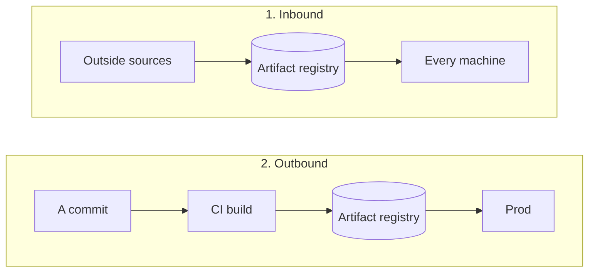
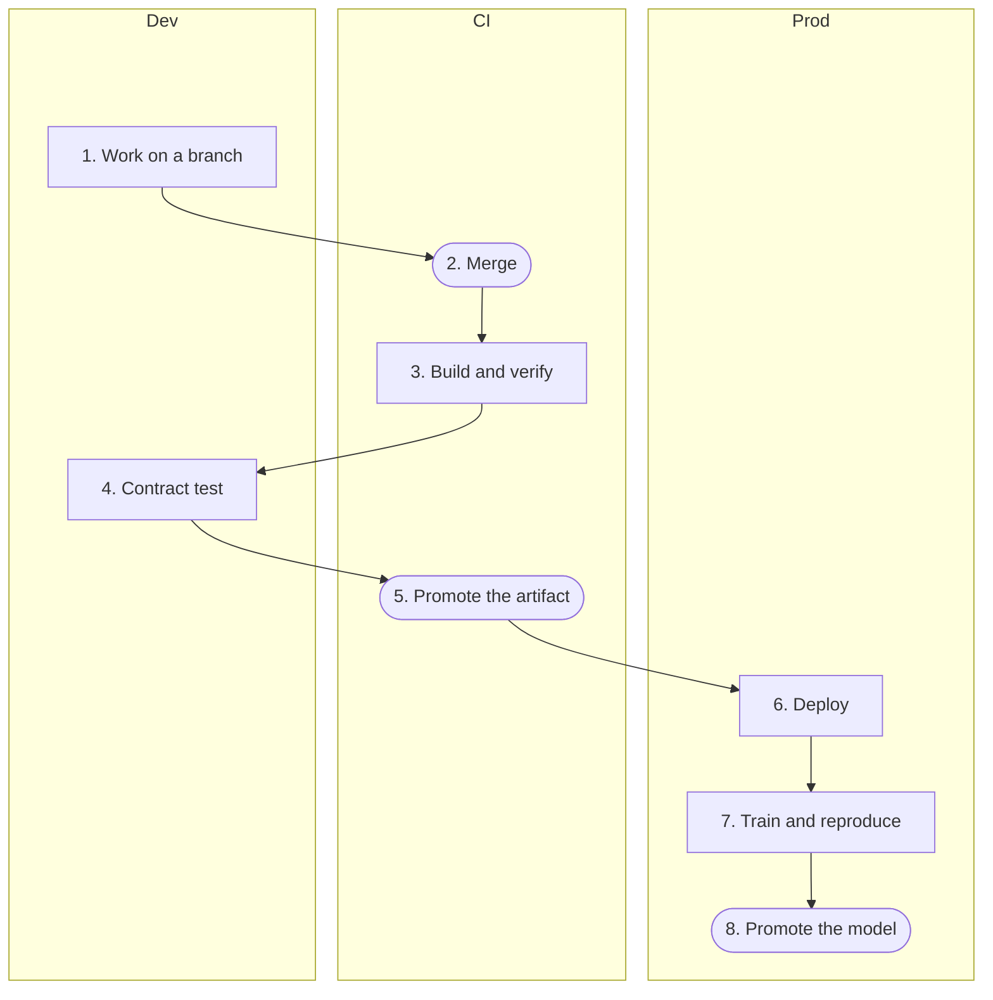

# Path to production

How code, data, and models get from development into production, the
environments they pass through, and the rules that keep those apart. The
reasons are in
[DR-0001](../../team/decisions/DR-0001-production-runs-ci-built-artifacts.md)
and [DR-0002](../../team/decisions/DR-0002-train-models-in-production.md).

## Two environments

The team works in two environments. What separates them is who can act in
each, not what they are called or how they are provisioned.

| | Dev | Prod |
|---|---|---|
| Who acts | People, under their own identity | Service accounts only |
| What data it sees | Production data, read-only. People write to their own spaces, which expire | Production data, read and write |
| What may run there | Anything: a branch, a notebook, a sample run | Only a released artifact that CI built from a commit |

- **Dev is where the work is done, on real data.** A model or a table
  checked on masked or stale data has not been checked, so development reads
  production data in place. The rules that make that safe are on
  [Development environments](environments.md#data-never-lands-on-a-machine).
- **Prod is where nothing is done by hand.** Every change arrives as a
  release. A person's decision, such as starting a training run or promoting
  a model, reaches production through CI.
- **The same rule holds for every kind of project.** A package, a model, the
  [feature factory](../../data/factory.md), and the
  [feature store](../../data/store.md) all ship this way. A person builds a
  table into their own space in dev, and a production table is built only
  from a released artifact, by a service account.

Any environment can be described by the same three rows.
[How many environments](#how-many-environments) uses them to compare the
other patterns with this one.

## The two rules

1. **Inbound: every outside input comes through the artifact registry.**
   Packages, language toolchains, operating system packages, base images,
   and pretrained models. No machine reaches a public package index, code
   host, or image registry directly.
2. **Outbound: production runs only what CI built from a commit.** Packages
   and containers built by CI and promoted from the registry's dev
   repositories to its release repositories, and models trained by a
   production pipeline. Nothing built on a workstation, laptop, VM, or
   notebook ships, and no machine image is ever saved and reused.

## From commit to production

A change takes the same steps however many environments there are. Adding an
environment changes where a step runs, not what it checks. Each column is
where a step runs, and a rounded step waits for a person.

1. **Work on a branch.** A person works in dev, on production data read in
   place.
2. **Merge.** CI runs the checks on every commit: lint, the
   [tests](testing.md) on synthetic data, no notebook with outputs, and
   every [data contract](conventions.md#data-contracts) valid, with a change
   that breaks a reader reported. A second person
   [reviews](conventions.md#branches-and-review) the change, and for a model
   checks that the repository documents its
   [training data](../../data/training-data.md) and its
   [predictions](../../data/predictions.md). The main branch then always
   holds work that could be released.
3. **Build and verify.** A version tag starts the release. CI builds one
   package for the version and fails if the tag and the package version
   differ. It publishes the package to the dev repository, installs it into
   a clean environment, and runs the tests again. The container is built
   from the published package, never from the source. This shows that the
   artifact works, not only the source tree, and that the container holds
   exactly what was verified.
4. **Contract test.** CI starts a run in dev from the candidate artifact,
   and every data object the project builds for others to read is tested
   against its contract: its columns, its types, its key, and its quality
   rules. A table that others read is an interface, so it is tested as built
   and not only as written.
5. **Promote the artifact.** A person approves, after any test that CI
   cannot yet run itself, such as one that needs a GPU. CI then copies the
   package and the container from the dev repositories to the release
   repositories. These are the same bytes, not a rebuild, and the approval
   is recorded.
6. **Deploy.** CI deploys the release to prod. Prod reads only the release
   repositories, so nothing else can run there.
7. **Train and reproduce.** For a model, the training pipeline runs with the
   released package and fails unless it reproduces the research run. See
   [Training in production](#training-in-production).
8. **Promote the model.** A person decides that the challenger becomes the
   champion.

Promotion means two things on this page. Promoting an artifact makes a
tested build available to production. Promoting a model makes a trained
version the one production scores with. Deploying is a third thing: putting
a released artifact into an environment.

CI holds no stored credentials. Each job exchanges its identity token for
short-lived credentials to the artifact registry and to the cloud, and the
cloud trusts only protected release tags of the project. The pipeline
definition lives in the project template: a project copies it and changes
variables, not stages. See [CI](../../technology/gitlab-ci.md).

## How many environments

Two is the rule. The patterns below are in order of size, with what each one
adds and what it costs. A team adds an environment when it has the problem
that environment solves, and not before.

### One

People and scheduled jobs share one environment, its identities, and its
data. Only care separates an experiment from a production run. It is where
most teams start, and it is the baseline the others are measured against.

### Two

Splitting dev from prod adds one thing: a production that only CI can
change. Every step in [From commit to production](#from-commit-to-production)
depends on it.

- **What it leaves open.** Dev and prod are granted different access, so a
  run in dev shows that the artifact and the pipeline work unattended, not
  that production will let them. The first real test of production's
  permissions, network, quotas, and schedules is the first production run.
- **What keeps that cheap.** Both environments are created from the same
  infrastructure code, so they differ as little as possible. And a model's
  first production run produces a challenger, which nothing downstream
  reads, so a failure costs a rerun.

Two is enough while a failed first run in production is cheap, as it is for
a batch model that starts as a challenger.

### Three: a rehearsal environment

The first environment a team adds. It sits between dev and prod and answers
one question: will this release run the way production is set up?

| | Rehearsal |
|---|---|
| Who acts | Service accounts only, as in prod |
| What data it sees | Production data, read-only. It writes to its own space |
| What may run there | The artifact that is about to be released, deployed the way prod deploys it |

- **It tests access, not logic.** Where infrastructure is declared in code
  and an artifact cannot change after it is built, the build settles whether
  the code behaves the same somewhere else. What still differs between
  environments is identity, permissions, network, quotas, schedules, and
  configuration. Those are tested only by an unattended run where they are
  set the way production sets them.
- **It reads production data in place.** Without that it cannot exercise
  the access it exists to test.
- **It is where a change to the infrastructure itself is tried first.**
- **Two steps move into it.** The deploy and the contract test run in
  rehearsal first, and the release reaches prod only after they pass there.
  A training pipeline is run end to end, on a sample where the full run is
  expensive. The reproduction gate stays in prod, because the model that
  ships is trained there.
- **What it costs.** A second copy of the infrastructure that has to stay
  the same as production's, because a pass in a rehearsal that has drifted
  shows nothing. One more step in every release. A second build of every
  table and a second run of every pipeline.

Add it when a failed first run in production is expensive: a change to the
infrastructure, or anything a consumer calls live.

### An integration environment

A special case, added for who needs access and not for what needs testing.

| | Integration |
|---|---|
| Who acts | People and service accounts, including people from outside the team |
| What data it sees | Nothing from production. Synthetic data only |
| What may run there | Candidate builds of services, tools, and their harnesses |

- **It is for people who are not cleared for production data**, and for a
  consuming team that needs something stable to build against while the
  real thing is still changing.
- **It cannot check a model or a table**, because it holds no real data.
- **Contract tests on synthetic data in CI do much of its work** without a
  standing environment. Add it when a team is building services or tools
  that others integrate with.

It was once the standard middle environment, because physical machines
differed from one another and their state had to be tested. Infrastructure
declared in code removed most of that reason, which is why the rehearsal
environment comes before it here.

### Four or more

A chain of four or five environments comes from the release process for
transactional applications. Each stage belongs to a different group and
answers a different question. That process treats the code as the thing
under test and the data as a fixture. For a model or a table the data is the
thing under test, so the stages in the middle, which hold masked or stale
data, cannot answer their questions. Each one is answered somewhere else.

| Traditional stage | Its question | What answers it here |
|---|---|---|
| Development | Does my change work? | Dev, on production data |
| System integration test | Do the pieces work together? | The tests in CI and the contract checks |
| User acceptance | Does the business accept it? | A challenger in production, which the business sees scoring real entities before a person promotes it |
| Pre-production | Will the deployment work the way production is set up? | The same infrastructure code for every environment and a first run that nothing reads. A rehearsal environment where that is not enough |

Where an organisation provisions more environments than a team needs, the
team uses the ones this page describes and leaves the rest empty.

*Add: which of the organisation's environments the team uses as dev and as
prod, which it leaves unused, whether it has added a rehearsal or an
integration environment, and the decision record for that choice.*

## Promotion

The artifact registry has two local repositories for each package type. CI
publishes every release candidate to the dev one. Promotion copies a tested
candidate to the release one. Developers, production, and the mirror that
the cloud's runtimes pull from can read only the release side, so an
untested build cannot reach production even by mistake. See
[the artifact registry](../../technology/artifactory.md).

## Containers

Services, jobs, pipelines, and workstations all run containers, and CI-built
containers are production artifacts like any package. The rule is that a
container is built by CI from published packages. A container or VM image
captured from a running machine is never one.

## Models

A model is the output of a recipe, so production ships the recipe:

- **Bytes in our bucket, in open formats.** Each version is a folder with the
  model file and a metadata file: git commit, package version, training data
  snapshot, config, and metrics.
- **The model registry is the catalog.** It points at the folder and holds
  the versions and the challenger and champion aliases. Changing registries
  would mean re-pointing a catalog, not moving models.
- **One module talks to the registry.** A project registers, promotes, and
  resolves a model through its own registry module, never through the
  registry's client directly.
- **Serving uses our own container**, not one the platform prebuilds.

## Serving

Serving is batch first. A scheduled batch job scores the input table,
writes the output table, and appends every prediction to the
[prediction log](model-monitoring.md#the-prediction-log). Consumers read the
output table, or the lookup service, a small web service that holds the
latest batch in memory and answers by entity id. Nothing scores a request
live. Move to microbatch, a cache store, or real-time scoring only when
freshness or latency demand it, and record why in a decision record. The
reasons are in [DR-0004](../../team/decisions/DR-0004-serve-from-batch.md).

The lookup service is small on purpose: it reloads the latest batch when its
copy is older than a configured age, answers one prediction route by entity
id, and exposes a health check. It has no model inside it.

## Training in production

Production models are trained by a production pipeline running released code. A
model trained in research is evidence the approach works, not the thing that
ships.

1. **You ship the recipe, not the model.** Research calls the package's
   training function. Production calls the same function with the same
   committed config, packaged inside the release.
2. **Reproducing the research run is the first gate.** The research run is
   logged to the [tracking server](experiment-tracking.md) with a fixture of
   its holdout rows and scores, and recorded in the config by run id.
   Production training fails if no run is recorded, if a metric is outside
   the tolerance, or if its scores rank the fixture rows differently from
   the research scores. A mismatch almost always means leakage, hidden
   notebook state, or a data difference.
3. **Research uses samples, production does the full run.** For expensive models
   the production run is the only full-scale run.
4. **The template does the plumbing.** A data scientist writes the training
   and evaluation functions. An ML engineer pairs on each person's first
   pipeline.

### The retraining ladder

| Rung | Trigger | What is needed |
|---|---|---|
| Manual | A person starts the training job in CI | Where every model starts |
| Scheduled | A pipeline schedule | Stable data and a passing gate |
| Triggered | A drift or performance alert submits the training job | [Model monitoring](model-monitoring.md); optional per model |

Every rung produces a challenger. Promotion to champion is a person's decision
on every rung, made with the project's promote command, which also starts the
new version's monitor.

## Notebooks

Notebooks are for research. No production pipeline runs a notebook. Code worth
keeping moves into the package with a test, and the notebook imports the
package. Outputs are stripped before commit.
