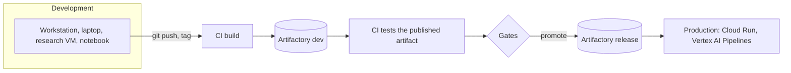

# Path to production

How code and models get from development into production, and the rules that
keep the two apart. The reasons are in
[DR-0001](../../team/decisions/DR-0001-production-runs-ci-built-artifacts.md)
and [DR-0002](../../team/decisions/DR-0002-train-models-in-production.md).

## The two rules

1. **Inbound: every external input comes through Artifactory.** Packages,
   language toolchains, OS packages, base images, and pretrained models. No
   machine reaches PyPI, GitHub, or Docker Hub directly.
2. **Outbound: production runs only what CI built from a commit.** Python,
   Rust, Node, and JVM packages and CI-built containers, promoted from the dev
   repositories to the release repositories, and models trained by a
   production pipeline. Nothing built on a workstation, laptop, VM, or notebook
   ships, and no machine image is ever saved and reused.



## The release, step by step

A version tag such as `v1.2.0` starts the release in GitLab CI. Merge requests
and the main branch run only the checks.

| Stage | What happens | Why |
|---|---|---|
| Check | Lint, tests, and a check that no notebook has outputs | Every commit |
| Build | Builds the wheel; fails if the tag and the package version differ | One version, one artifact |
| Publish | Uploads the wheel to the dev repository | Untested builds never reach release |
| Verify | Installs the published wheel into a clean environment and runs the tests against it | Proves the artifact works, not just the source tree |
| Image | Builds the container by installing the published wheel, never the source | The container runs exactly what was verified |
| Gate | Manual: GPU tests, run by hand until GPU runners exist | The pipeline waits; nothing is promoted until someone approves |
| Promote | Copies the wheel and the image from the dev repositories to the release repositories | The same bytes, not a rebuild, with an audit trail |
| Deploy | Deploys the release image to Cloud Run as a service and a batch job | Production reads only release repositories |
| Train | Manual: submits the training pipeline with the released package | See below |

CI holds no stored credentials. Each job exchanges its GitLab identity token for
a short-lived Artifactory token and short-lived Google credentials, and Google
trusts only protected release tags of the project.

??? example "The project pipeline, `.gitlab-ci.yml`"

    ```yaml
    --8<-- "examples/dev-env/project/.gitlab-ci.yml"
    ```

## Promotion

Artifactory has two local repositories for each package type. CI publishes every
release candidate to the dev one. Promotion copies a tested candidate to the
release one. Developers, production, and the Artifact Registry mirror that
Google's runtimes pull through can read only the release side, so an untested
build cannot reach production even by mistake. See
[Artifactory](../../technology/artifactory.md).

## Containers

Cloud Run, Vertex AI Pipelines, and Workstations run containers, and CI-built
containers are production artifacts like any package. The rule is that a
container is built by CI from published packages. A container or VM image
captured from a running machine is never one.

## Models

A model is the output of a recipe, so production ships the recipe:

- **Bytes in our bucket, in open formats.** Each version is a folder with the
  model file and a metadata file: git commit, package version, training data
  snapshot, config, and metrics.
- **The Vertex AI Model Registry is the catalog.** It points at the folder and
  holds the versions and the `challenger` and `champion` aliases. Leaving Vertex
  would mean re-pointing a catalog, not moving models.
- **One module talks to the registry.** Code calls `register`, `promote`, and
  `resolve` in the project's `registry` module, never the Vertex SDK directly.
- **Serving uses our own container**, not a Vertex prebuilt one.

## Serving

Serving is batch first. A scheduled Cloud Run job scores the input table,
writes the output table, and appends every prediction to the
[prediction log](model-monitoring.md#the-prediction-log). Consumers read the
output table, or the lookup service, a FastAPI app on Cloud Run that holds the
latest batch in memory and answers by entity id. Nothing scores a request
live. Move to microbatch, a cache store such as Bigtable, or real-time scoring
only when freshness or latency demand it, and record why in a decision record.
The reasons are in [DR-0004](../../team/decisions/DR-0004-serve-from-batch.md).

```python
--8<-- "examples/dev-env/project/src/example_model/serve.py"
```

## Training in production

Production models are trained by a production pipeline running released code. A
model trained in research is evidence the approach works, not the thing that
ships.

1. **You ship the recipe, not the model.** Research calls `train(config)` from
   the package. Production calls the same function with the same committed
   config, packaged inside the release.
2. **Reproducing the research run is the first gate.** The research run is
   logged to [MLflow](experiment-tracking.md) with a fixture of its holdout
   rows and scores, and recorded in the config by run id. Production training
   fails if no run is recorded, if a metric is outside the tolerance, or if its
   scores rank the fixture rows differently from the research scores. A
   mismatch almost always means leakage, hidden notebook state, or a data
   difference.
3. **Research uses samples, production does the full run.** For expensive models
   the production run is the only full-scale run.
4. **The template does the plumbing.** A data scientist fills in `train` and
   `evaluate`. An ML engineer pairs on each person's first pipeline.

```python
--8<-- "examples/dev-env/project/src/example_model/gate.py"
```

### The retraining ladder

| Rung | Trigger | What is needed |
|---|---|---|
| Manual | A person starts the train job in GitLab | Where every model starts |
| Scheduled | A pipeline schedule | Stable data and a passing gate |
| Triggered | A drift or performance alert submits the train job | [Model monitoring](model-monitoring.md); optional per model |

Every rung produces a challenger. Promotion to champion is a person's decision
on every rung, made with `example-model promote`, which also starts the new
version's monitor.

## Notebooks

Notebooks are for research. No production pipeline runs a notebook. Code worth
keeping moves into the package with a test, and the notebook imports the
package. Outputs are stripped before commit.
