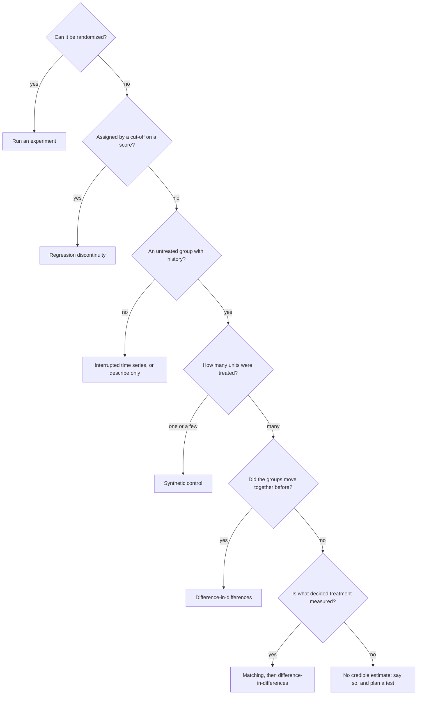

# Measuring impact without an experiment

How to choose a design when the action has already happened, or cannot be
randomized, and the business still wants to know what it did. This page is
the map. Each design on it has, or will have, a page of its own.

## What it is

Observational causal analysis: estimating the effect of an action from data
in which nobody controlled who received it. Every design here is a different
answer to one question, namely what stands in for the outcome the treated
units would have had without the action. Each answer rests on an assumption
that the data cannot confirm. The work of an observational study is choosing
the design whose assumption is most believable for the case in hand, checking
everything about it that can be checked, and reporting the result with the
assumption attached. The designs differ far more in what they assume than in
their statistics.

## When it is the right choice

- The action cannot be withheld at random: a price change, a regulation, a
  store opening, a product launch, a change to a contract.
- The action has already been taken and no holdout was kept.
- An experiment is possible but the business will not run one, and a
  decision will be made on some number regardless.
- As a first estimate, to decide whether an experiment is worth its cost.

## When it is not

- **An experiment is possible and the decision can wait for it.** Every
  design here is second best. See
  [experiments and lift tests](experiments-and-lift-tests.md).
- **The action went to everyone at once and the outcome has no stable
  history.** There is nothing to compare with.
- **The reason units were treated is unknown.** Without knowing how
  treatment was assigned, no design can be chosen or defended.
- **The result is wanted to justify a decision already made.** An
  observational estimate has enough free choices in it to support most
  conclusions. Fix the design before seeing outcomes, or do not start.

## Assumptions

Every design on this page needs the first two. Every design with a
comparison group needs the third. Each then adds its own, listed in the table
of approaches.

| Assumption | What it means | How it is checked |
|---|---|---|
| A defined action | "Treated" means one thing, and the comparison is to one alternative | Written down before the analysis |
| No interference | A unit's outcome does not depend on whether other units were treated | By the choice of unit and comparison group. Knowledge of the business |
| Overlap | For every kind of treated unit there are untreated units of the same kind | Compare the treated and untreated on what is known about them before the action. Where there is no overlap, the data cannot say anything about those units |
| The design's own stand-in | The comparison is what the treated units would have been | Never directly. By placebo tests and by argument from how treatment was assigned |

## Start from how treatment was assigned

The design follows from the answer to one question: **why did these units
get the action and not those?** Ask the people who made the decision, not the
data.

The chart covers the common cases. Regression adjustment and instrumental
variables are in the table below.

The last box is a real outcome and an acceptable one to report. A design
whose assumption plainly fails does not become usable because nothing better
is available.

## Common approaches

| Design | What it needs | What it rests on | Main weakness |
|---|---|---|---|
| Before and after | The outcome before and after, for the treated units | Nothing else changed | Credits the action with season, trend, and every other event |
| Interrupted time series | A long history for the treated units | The earlier level and trend would have continued | Anything else that happened on the date. A slow rollout |
| [Difference-in-differences](difference-in-differences.md) | Treated and untreated units, several periods before and after | Both groups would have moved by the same amount | Treated units chosen for how they were trending |
| [Synthetic control](synthetic-control.md) | One or a few treated units, many untreated ones, a long history | A weighted mix of untreated units that tracked the treated one before would have kept tracking it | Few units means inference is weak. Needs untreated units that are truly unaffected |
| [Matching](matching.md) and weighting | Rich data on each unit from before the action | Everything that drove both treatment and the outcome is measured | An unmeasured reason for treatment. The most common failure in customer data |
| [Regression](regression.md) adjustment | The same | The same, plus that the model's form is right | Hides poor overlap by extrapolating |
| Regression discontinuity | Treatment given to units above a cut-off on a score, and many units near the cut-off | Units just either side of the cut-off are alike | Estimates the effect only for units at the cut-off. Fails if units can push themselves over it |
| Instrumental variables | Something that moves treatment and affects the outcome in no other way | That such a thing exists, which is rarely certain | Estimates the effect only for units the instrument moved. Weak instruments give wild estimates |

Two designs here have no page of their own yet.

**Regression discontinuity.** Where a rule assigns treatment by a threshold,
such as a loyalty tier at a level of spend, free delivery above a basket
size, or a credit offer above a score, customers just above and just below
the line differ in little except the treatment. The jump in the outcome at
the line is the effect. It is the most credible of the observational
designs when the rule was followed and customers could not place themselves
on one side. The score is called the running variable. The analysis keeps
customers within a chosen distance of the line, the bandwidth, fits a line to
the outcome on each side, and reads the gap between the two at the line.
Check for a pile-up of customers just over the line.

**Instrumental variables.** Where something outside the customer's control
nudged some toward treatment, the effect can be estimated from the nudge
alone. The most useful case is one the team creates: a randomized
*encouragement*, such as an invitation to join a programme sent to a random
half. Who joins is self-selected, but who was invited is random, and that is
enough to estimate the effect of joining for the customers the invitation
persuaded: the difference in outcome between the invited and the uninvited ÷
the difference in the share who joined. Those customers are called
compliers, and the estimate a local average treatment effect.

### Combining designs

The designs combine, and the combinations are often stronger than either
part. The most useful: match treated units to untreated units on their
characteristics and their history before the action, then estimate by
difference-in-differences on the matched set. Matching makes the groups
alike at the start. Differencing removes what remains fixed between them.

### Design before outcomes

Write the analysis down before looking at any outcome after the action: the
units, the comparison group and how it is chosen, the outcome and window,
the method, and the checks. Then run it once. A helpful discipline is to
describe the experiment one would have run, with its eligibility rules, its
arms, its start date, and its outcome, and then make the observational
analysis copy it as closely as the data allows. Most errors in observational
studies come from departing from that imagined experiment, in particular by
defining groups using things that happened after the start.

### Stress tests that apply to every design

- **A placebo outcome.** Estimate the effect on something the action could
  not have changed. A non-zero result means the groups differ for other
  reasons.
- **A placebo time or group.** Apply the method to a date when nothing
  happened, or to units that were not treated.
- **A range, not a point.** Rerun under each reasonable alternative: another
  comparison group, another window, another set of covariates. Report how
  far the estimate moves.
- **A sensitivity analysis.** Ask how strong an unmeasured cause would have
  to be to explain the result away, and whether a cause that strong is
  plausible. Rosenbaum's bounds and the E-value are two standard forms.
- **A comparison with an experiment.** Where any experiment on a similar
  action exists, check that the method recovers its answer. This is the only
  direct test an observational method can be given.

## Reading a result you did not produce

Questions to ask of an estimate of impact that did not come from a
randomized test.

- **How did units come to be treated?** If the author cannot say, the design
  was chosen without knowing whether its assumption could hold.
- **What is the comparison group, and who chose it, when?** A comparison
  chosen after the outcomes were visible is a choice among answers.
- **What does the picture before the action look like?** Ask for the treated
  and comparison outcomes plotted over time. If they did not move together
  before, there is no reason to think they would have after.
- **What else happened then?** Another campaign, a price change, a
  competitor, a system change, a holiday. Check the insights log.
- **Were any units dropped, and which?** Trimming units without a match
  changes who the estimate is about.
- **Was anything used to define the groups that happened after the action?**
  "Customers who engaged with the programme" as the treated group is the
  classic case.
- **Is there a placebo test, and what did it show?**
- **How does the size compare with what experiments find?** An observational
  estimate several times larger than any tested effect of a similar action
  is more likely bias than a breakthrough.
- **What is the interval, and what does it cover?** Sampling variation only.
  The uncertainty from the assumption is not in it, and is usually larger.
- **What grade of evidence is claimed, and do the words match it?** See
  [directional versus causal](directional-versus-causal.md#saying-it).

## Where it applies to our data

*Add: the actions whose impact the team is asked for and cannot randomize,
with how each is assigned and the design the team uses for it.* Why: the same
kinds of action recur, and the design should not be chosen fresh each time
with the result in view.

*Add: any experiments on record that can serve to test an observational
method.* Why: it is the only direct check available.

*Add: where the reasons for business decisions are recorded.* Why: the
assignment mechanism is the first thing every design needs, and it is rarely
in the data. See the [decision log](../oversight/decision-log.md).

## Lessons learned

None recorded yet.

## Reference implementations

None yet.

## Further reading

Angrist, Joshua D., and Jörn-Steffen Pischke. *Mostly Harmless Econometrics:
An Empiricist's Companion.* Princeton University Press, 2009. Organised by
design: regression, instrumental variables, differences-in-differences,
regression discontinuity. The common reference among applied economists.

Cunningham, Scott. *Causal Inference: The Mixtape.* Yale University Press,
2021. The same designs, more informally, with code and many examples.

Huntington-Klein, Nick. *The Effect: An Introduction to Research Design and
Causality.* Chapman and Hall/CRC, 2021. The gentlest of the three, and the
one that spends longest on choosing a design before any estimation.

Rosenbaum, Paul R. *Design of Observational Studies.* Springer, 2010. The
case for treating an observational study as a designed object, with
sensitivity analysis for unmeasured causes.

Rubin, Donald B. "For Objective Causal Inference, Design Trumps Analysis."
*The Annals of Applied Statistics* 2, no. 3 (2008): 808–840. Why the design
should be fixed before outcomes are seen.

Hernán, Miguel A., and James M. Robins. "Using Big Data to Emulate a Target
Trial When a Randomized Trial Is Not Available." *American Journal of
Epidemiology* 183, no. 8 (2016): 758–764. The discipline of specifying the
experiment one would have run and copying it.

Imbens, Guido W., and Jeffrey M. Wooldridge. "Recent Developments in the
Econometrics of Program Evaluation." *Journal of Economic Literature* 47, no.
1 (2009): 5–86. A technical survey of the methods and their assumptions.

Athey, Susan, and Guido W. Imbens. "The State of Applied Econometrics:
Causality and Policy Evaluation." *Journal of Economic Perspectives* 31, no.
2 (2017): 3–32. A shorter survey, including the newer methods.

Lee, David S., and Thomas Lemieux. "Regression Discontinuity Designs in
Economics." *Journal of Economic Literature* 48, no. 2 (2010): 281–355. The
guide to regression discontinuity.

Angrist, Joshua D., Guido W. Imbens, and Donald B. Rubin. "Identification of
Causal Effects Using Instrumental Variables." *Journal of the American
Statistical Association* 91, no. 434 (1996): 444–455. What an instrumental
variables estimate is an estimate of.

LaLonde, Robert J. "Evaluating the Econometric Evaluations of Training
Programs with Experimental Data." *American Economic Review* 76, no. 4
(1986): 604–620. The original demonstration that observational methods can
fail to recover an experimental result. Gordon and others (2019), cited on
the [directional versus causal](directional-versus-causal.md) page, is the
marketing counterpart.
