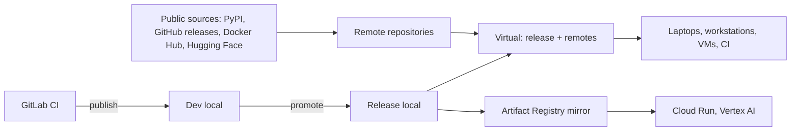

# Artifactory

## What it is for

The only source of packages, toolchains, images, and pretrained models, and the
only store of what we release. No machine reaches public registries directly.
The rules it serves are on [Path to production](../methods/development/path-to-production.md).

## Architecture

Each package type has five repositories:

| Repository | Holds | Who reads it |
|---|---|---|
| `<type>-dev-local` | Every release candidate CI publishes | CI verify jobs |
| `<type>-release-local` | Promoted, tested releases | Everyone, through the virtual |
| `<type>-remote` | Caches of public sources | Everyone, through the virtual |
| `<type>` (virtual) | Release plus remotes | Developers and production |
| `<type>-dev` (virtual) | Dev plus release plus remotes | CI verify jobs only |

Google's runtimes pull images from Artifact Registry, so each GCP project has a
remote Artifact Registry repository that caches Artifactory. The production one
uses a token that can read the release repository and nothing else.

## How we use it

- **Python:** uv's default index is `{{ platform.dev.artifactory_url }}/artifactory/api/pypi/pypi/simple`.
  Python itself installs through the `github-releases` remote.
- **Docker:** images are `<artifactory-host>/docker/<image>` for pulls, and CI
  pushes to `docker-dev-local`.
- **Tools on laptops:** uv and the Google Cloud CLI download through generic
  remotes. See [Set up a Mac](set-up-a-mac.md).
- **Pretrained models:** set `HF_ENDPOINT` to the `huggingface` remote.
- **Credentials:** people use an identity token in `~/.netrc`. Workstations and
  research VMs read a read-only token from the [secret manager](secrets.md). CI
  exchanges its GitLab identity token for a short-lived one.

The repositories are defined in the infrastructure repository's Artifactory
module, one block per package type, so adding a package type is a merge
request there.

## Limits and quotas

Storage quota: *[unverified: needs source]*.

## Owner and support path

Owner: {{ platform.components.artifactory.owner }}. Support:
{{ platform.components.artifactory.support_channel }}.

## Runbooks

- **A package is missing.** Request it through the remote: the first install
  caches it. If the remote cannot fetch it, ask the owner to check the remote's
  upstream.
- **Adding a language.** See [Add a language toolchain](add-a-language-toolchain.md).
- **A release must be withdrawn.** Delete it from the release repository, not
  the dev one, and deploy the previous version.
