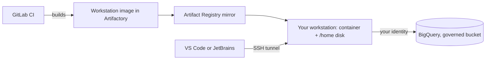

# Cloud Workstations

## What it is for

Everyone's daily development machine. Why it is the default, and what belongs
on it, is on [Development environments](../methods/development/environments.md).

## Architecture

- **Image:** Google's Code OSS base, plus uv, the Artifactory configuration,
  the JetBrains Toolbox Agent with a PyCharm {{ platform.dev.pycharm_version }}
  backend, and startup scripts that write your Artifactory credentials and
  register the backend. Rebuilt by CI, never changed by hand. The Agent is build
  {{ platform.dev.jetbrains_toolbox_build }}, and the Toolbox App on laptops
  must be the same build, so the two are upgraded together.
- **Configuration:** one for the team, {{ platform.dev.workstation_machine_type }},
  with a {{ platform.dev.workstation_home_disk_gb }}GB home disk that is deleted
  when the workstation is.
- **Network:** no public IP. The workstation reaches Artifactory through the dev
  network.

## How we use it

1. Start your workstation in the console or with `gcloud workstations start`.
2. Connect your editor: [VS Code](connect-vs-code.md) or [JetBrains](connect-jetbrains.md).
3. Sign in once with your own identity: `gcloud auth login` and
   `gcloud auth application-default login`.
4. Clone, `uv sync`, work, push.

## Limits and quotas

- Stops after {{ platform.dev.workstation_idle_minutes }} minutes idle and
  {{ platform.dev.workstation_max_hours }} hours running.
- Google charges a management fee per vCPU on top of compute, so large machines
  belong on [research VMs](research-vms.md).
- Workstation quota in the dev project: *[unverified: needs source]*.

## Owner and support path

Owner: {{ platform.components.workstations.owner }}. Support:
{{ platform.components.workstations.support_channel }}.

## Runbooks

- **Replace your workstation.** Push everything, then ask for it to be recreated
  through the Terraform change that lists you. The new one starts from the
  current image with an empty home.
- **A tool is missing.** Add it to the image, not to your home: open a merge
  request on the image repository.
- **Artifactory says 401.** The startup script writes `~/.netrc` at each start.
  Restart the workstation; if it persists, the token in the secret manager has
  expired.
