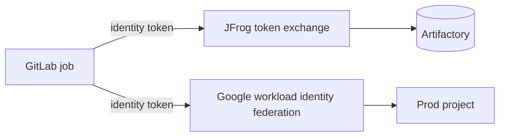

# GitLab CI

## What it is for

Builds, tests, publishes, promotes, deploys, and starts production training. It
is the only route into production. The stages are explained on
[Path to production](../methods/development/path-to-production.md).

## Architecture



No job holds a stored credential. Artifactory and Google each trust GitLab's
signed identity token for the job, and Google trusts only protected release tags
of the project.

## How we use it

- Copy the pipeline from the project template. Projects change the variables,
  not the stages.
- Release by pushing a tag `vX.Y.Z` matching the version in `pyproject.toml`.
- Approve the gate job after running the GPU tests by hand.
- Start production training with the manual train job.

```sh
--8<-- "examples/dev-env/project/scripts/ci/artifactory-auth.sh"
```

## Limits and quotas

Runner capacity: *[unverified: needs source]*. There are no GPU runners yet,
which is why GPU tests are a manual gate.

## Owner and support path

Owner: {{ platform.components.ci.owner }}. Support:
{{ platform.components.ci.support_channel }}.

## Runbooks

- **The build job fails on the version check.** The tag and `pyproject.toml`
  disagree. Fix the version and tag again; a version number is never reused.
- **Verify fails but tests pass locally.** The wheel is missing a file, often
  package data. Check the wheel's contents.
