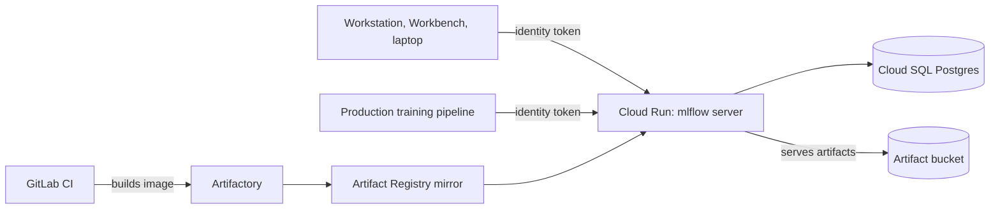

# MLflow tracking server

## What it is for

Recording research runs and the production runs that reproduce them: params,
metrics, tags, datasets, and artifacts. How to use it from code is on
[Experiment tracking](../methods/development/experiment-tracking.md). It is
not the model registry; that is [Vertex AI](vertex-ai.md).

## Architecture

MLflow's own GCP recipe: the server on Cloud Run, the backend store in Cloud
SQL, artifacts in a bucket the server proxies so clients need no bucket access.
The service requires IAM authentication. The project's MLflow plugin attaches a
Google identity token to every request: a service account's token for the
service URL, or a person's token from `gcloud`. It lives in the dev project; the
production training service account is granted access so its runs land beside
the research runs. The service, the database, the bucket, and the access
grants are one module in the infrastructure repository; the server image is
built by CI from a pinned MLflow version.

## How we use it

- The tracking URI setting is `{{ platform.dev.mlflow_url }}` in every
  project's `.env`, and a CI variable carries the same address.
- One experiment per model, named after the model.
- The UI at the same address, for comparing runs and reading artifacts.
- Fixtures do not go here: they go to the governed bucket, and the run records
  where.

### What to log, by library

Params are what you need to re-run the fit. Metrics are what you use to choose
between fits. Anything else is an artifact. The rule is on
[Experiment tracking](../methods/development/experiment-tracking.md#what-to-log).

| Library | Params | Metrics | Artifact |
|---|---|---|---|
| scikit-learn | `model.get_params()`, flattened to `clf__C` style | Your `evaluate()`, or `mlflow.models.evaluate` for the standard set with plots | The fitted pipeline, if you will come back to it |
| statsmodels | Formula or exog names, family, fit method | `aic`, `bic`, `llf`, pseudo R², convergence, plus your decision metric | `summary().as_text()`: the coefficient table is what you reread |
| PyTorch | The hyperparameter dict you already have | Final-epoch metrics | The loss curve as a CSV. Time-series metrics need a TensorBoard instance, which we do not run |
| scipy | Initial guess, bounds, method | Fitted parameters, residual norm, `success`, `nfev` | None |

A grid search is one decision, not fifty runs: log the grid as params, the best
point's metrics, and `cv_results_` as a CSV artifact.

Autolog is off. MLflow's `autolog()` covers scikit-learn and statsmodels, but it
logs every `fit()` inside a cross-validation and knows nothing about the data
snapshot. Switch it on in a cell for a grid search if you want the parent and
child runs; otherwise log what you chose.

## Limits and quotas

- Cloud Run scales to zero. The database is the only always-on cost, on the
  smallest tier until it is slow.
- Database and artifact storage limits: *[unverified: needs source]*.

## Owner and support path

Owner: {{ platform.components.mlflow.owner }}. Support:
{{ platform.components.mlflow.support_channel }}.

## Runbooks

- **Upgrade.** Bump the MLflow version in the server image's CI
  configuration, let CI build, then change the image tag in the dev
  infrastructure. The server runs schema migrations at start; take a Cloud SQL
  backup first.
- **403 from a workstation.** You are not in the team group, or the token is
  stale: `gcloud auth login` again. The plugin caches a token for 45 minutes.
- **The UI is slow to open.** Cold start after scaling to zero. Wait, do not
  raise the minimum instances unless it happens all day.

## Known issues

- Runs logged from a dirty checkout cannot become the reference, by design.
  People find this out the first time they try.
