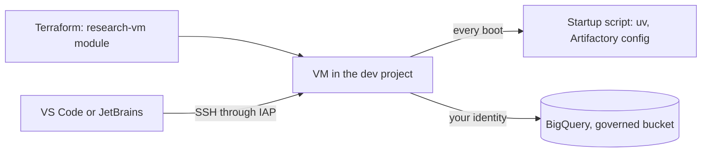

# Research VMs

## What it is for

Interactive work that needs more memory than a workstation, or a GPU. Batch
work of the same size goes to a Vertex AI custom job instead, which stops when it
finishes. Research VMs are development machines: production never runs on them
or on images made from them.

## Architecture



| Profile | Machine type | For |
|---|---|---|
| CPU, 128GB | `n2-highmem-16` | Large in-memory data work |
| CPU, 256GB | `n2-highmem-32` | Larger still |
| GPU | `g2-standard-16`, one L4 | Model training and tuning |

The GPU profile uses a Deep Learning VM image, so the driver comes with the
image. The driver, the CUDA toolkit if one is installed, and the CUDA version of
the Python wheels must match.

## How we use it

1. Add a `research_vm` entry for yourself in the dev Terraform and open a merge
   request. See [Request a research VM](request-a-research-vm.md).
2. Connect through IAP with the SSH configuration on the
   [VS Code](connect-vs-code.md) or [JetBrains](connect-jetbrains.md) page.
3. Clone, `uv sync`, work, push. Data stays in BigQuery and the governed bucket.

The startup script rebuilds the VM's wiring at every boot:

```bash
--8<-- "examples/dev-env/infra/modules/research-vm/startup.sh.tftpl"
```

## Limits and quotas

- Every research VM stops at {{ platform.dev.research_vm_stop }}. The module has
  no option to turn this off. Start it again when you need it.
- GPU quota in the dev project: *[unverified: needs source]*.

## Owner and support path

Owner: {{ platform.components.research_vms.owner }}. Support:
{{ platform.components.research_vms.support_channel }}.

## Runbooks

- **Replace a VM.** Push everything, then delete and recreate it through
  Terraform. Nothing on the disk is the only copy.
- **Release a VM you no longer need.** Remove your `research_vm` entry; the VM
  and its disk are deleted.
