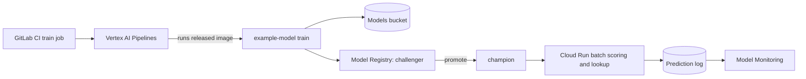

# Vertex AI

## What it is for

The ML-specific parts of Google Cloud we use: pipelines for production training,
the model registry as a catalog, model monitoring for drift, custom jobs for
large research runs, and Workbench for notebooks. Experiments are tracked on [MLflow](mlflow.md).

## Architecture



## How we use it

| Feature | Use | Not used for |
|---|---|---|
| Pipelines | Production training, from the released container | Running notebooks |
| Model Registry | Catalog of versions and aliases, pointing at our bucket | Storing model bytes in a Vertex format |
| Experiments | Not used: runs go to [MLflow](mlflow.md). Kept as the fallback tracker | |
| Model Monitoring | Feature and prediction drift on the prediction log, per champion version | Feature attribution, which needs Vertex serving |
| Custom jobs | Large research runs from a workstation | Production work outside a pipeline |
| Workbench | Notebooks with the team image | Production |
| Feature Store | Online serving of feature tables built in BigQuery | Owning the feature definitions |
| Endpoints | Not used yet: serving runs on Cloud Run | |

Code reaches the registry through one module, so a change of registry changes one
file:

```python
--8<-- "examples/dev-env/project/src/example_model/registry.py"
```

## Limits and quotas

Training and GPU quotas in the prod project: *[unverified: needs source]*.

## Owner and support path

Owner: {{ platform.components.vertex_ai.owner }}. Support:
{{ platform.components.vertex_ai.support_channel }}.

## Runbooks

- **Promote a challenger.** Compare it with the champion, then call
  `registry.promote` with its version. Serving picks it up on the next deploy.
- **Roll back.** Move the `champion` alias back to the previous version.
