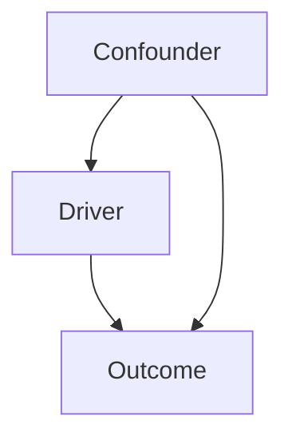

# What moves <outcome>

## Outcome

Link to the KPI page.

## Diagram

## Assumptions

The nodes and edges the team is least sure about.

## Evidence

What has been tested, with links.

## What we would need to believe to change this

