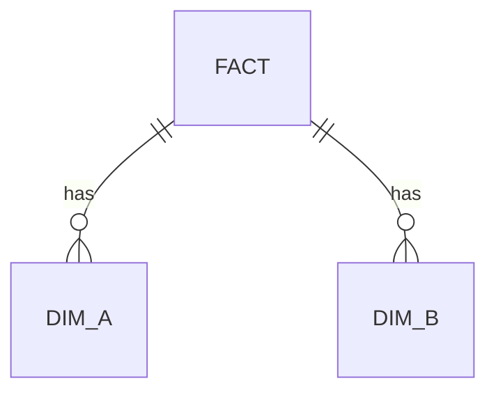

# <Domain name> data

## Scope

## Model

Grain of each core table, one line each. Entities and semantics that matter
across these tables.

## Canonical tables

Describe each table here. Give a table its own dataset page when it outgrows
this one.

| Table | Grain | What it holds | Columns that matter |
|---|---|---|---|
| | | | |

## How to join

The keys that work and the ones that do not.

## Conventions

Naming, partitioning, history handling.

## Owner

## Quirks

Optional. Structural and timeless.

## Insights

Optional. Events that change how the data is read. Format in spec section 6.

