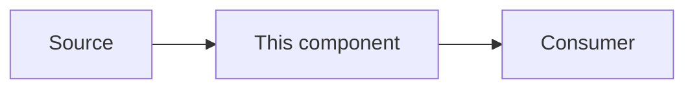

# <Component name>

## What it is for

## Architecture

## How we use it

## Limits and quotas

Quota: {{ platform.components.warehouse.quota }} {{ platform.components.warehouse.quota_unit }}, as of {{ platform.as_of }}.

## Owner and support path

Owner: {{ platform.components.warehouse.owner }}. Support: {{ platform.components.warehouse.support_channel }}.

## Runbooks

## Known issues

Optional.

## Insights

Optional. Events that change how the data is read. Format in spec section 6.

